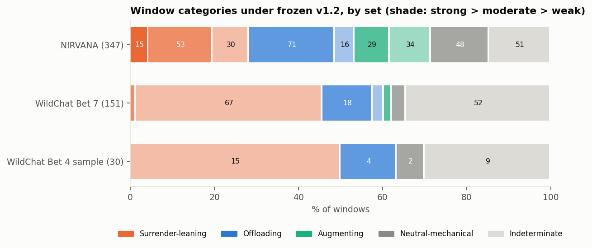
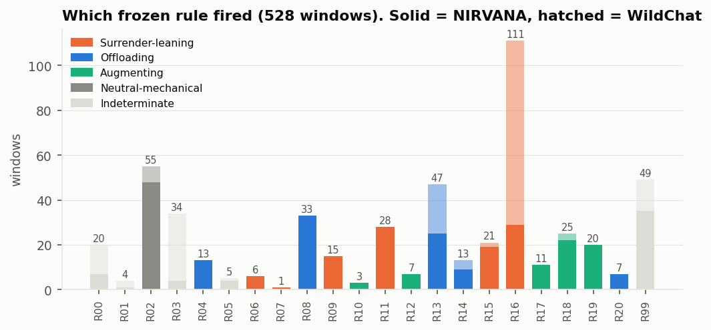
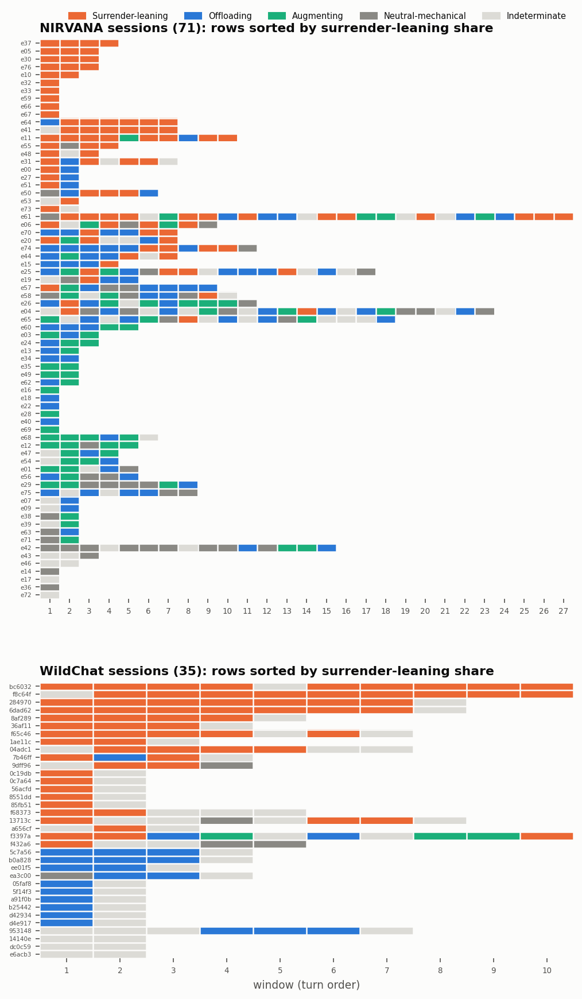
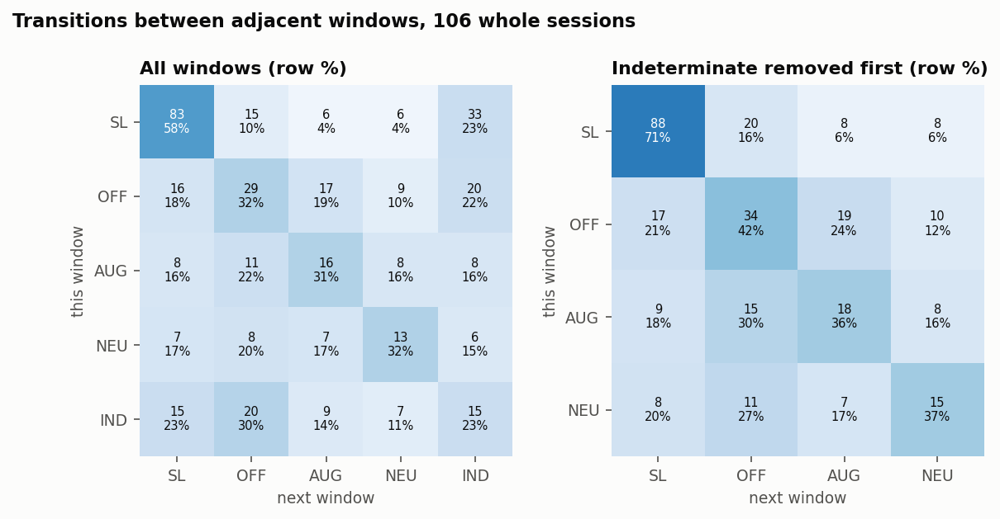
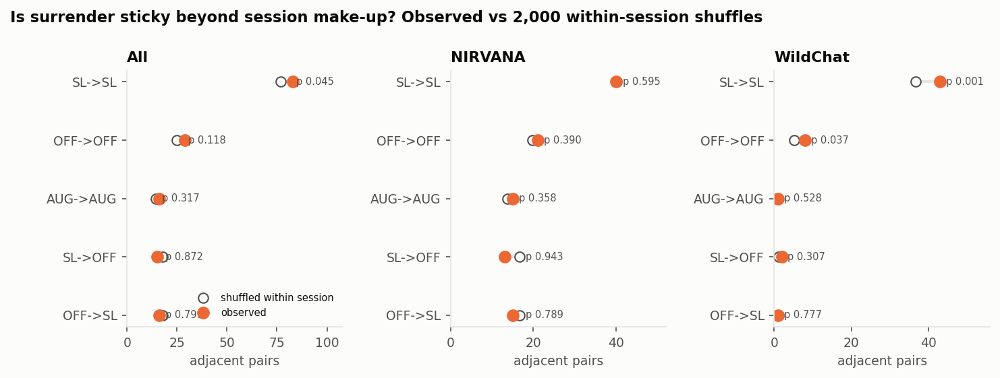
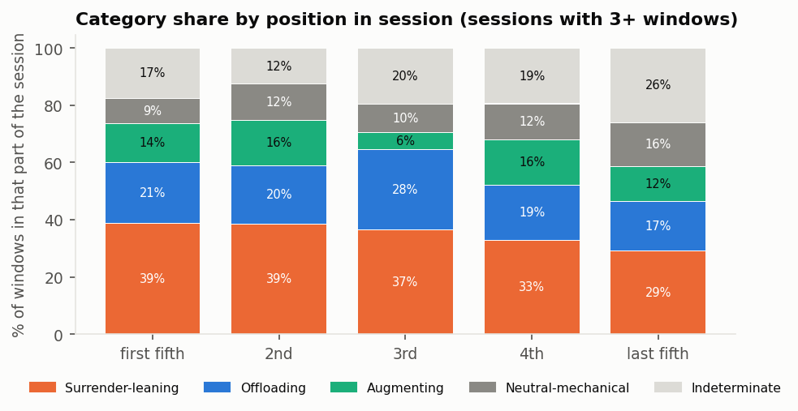
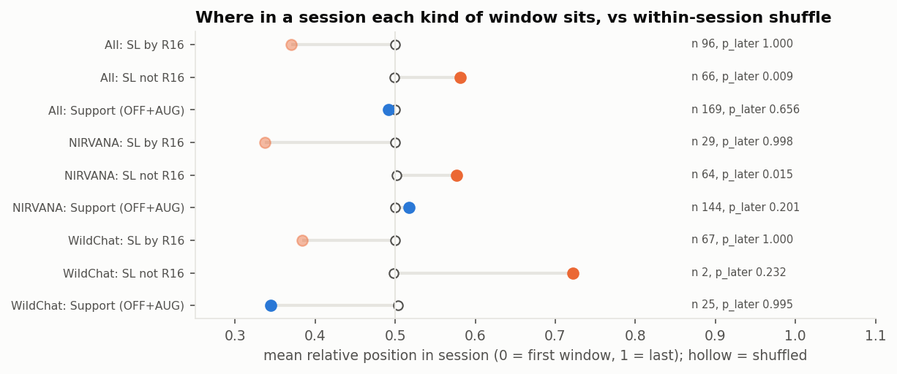
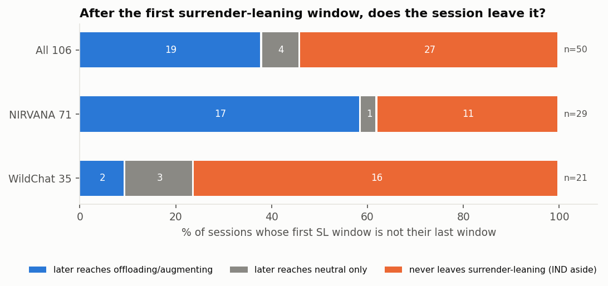

# Offloading or Surrendering? Milestone 2 draft

Wayne Wang · CSE 216 / COGS 230, Fall 2026 · Draft for Wayne's read on Nov 14; due Nov 15.

**How to read this draft.** Every number comes from a script that reruns from committed labels with no model calls (`sh Final_Project/analysis/scripts/run_all.sh`). Each claim points to the file that holds it. Findings were attacked by a separate skeptic agent (`analysis/SKEPTIC.md`); the counterpoints it raised are stated next to the findings below. Narratives are in `narratives.md`. No dataset text is quoted anywhere.

**What Milestone 2 asks for, and where it is.** The course handout is not in the repository. The requirements below are taken from the project brief (`BRIEF.md`, "Milestone 2 requires"), which summarizes the course materials; `Reflection/` holds only my method and contribution reflections and does not restate them. If the handout asks for something else, this draft has not seen it.

| Requirement (from `BRIEF.md`) | Section |
|---|---|
| Systematic comparison with existing frameworks (Risko & Gilbert, Shaw & Nave, PAUSE, Maier), with cases each cannot distinguish | §4 |
| Review of related work | §3 |
| Codebook applied to 50–100 sequences | §5 (applied to 106 whole sessions, 528 windows) |
| Agreement statistics and analyzed disagreements | §6 |
| Revised framework | §5.3, §9 |
| Honest reporting of problems and adaptations | §2, §10 |

---

## 1. Summary

I asked which observable patterns of AI use in writing resemble *offloading* (the writer keeps the substance and hands over a demand) and which resemble *surrender* (AI substance taken over with no visible check). AI coders labeled every request window in 106 whole writing sessions (71 timed-essay sessions from NIRVANA, with chat and editor; 35 formal long-form writing conversations from WildChat, chat only) with behavior codes. A rule table, written from the literature and frozen before these labels existed, turned each window's codes into one of five categories with a strength.

- **The frozen rules held up out of sample.** 78.5% of the 428 new windows received a category other than indeterminate, against 79% on the 100 windows the rules were built on (§7.1).
- **The mix depends on what the log can see.** In NIRVANA (chat and editor) 28% of windows lean toward surrender and 43% toward support; in WildChat (chat only) 46% and 17%. Most surrender-leaning windows are weak, and in WildChat almost all rest on what was *asked* ("write this for me"), since nothing shows what happened to the text (§7.1).
- **Surrender-leaning sorts sessions; it is not sticky from turn to turn.** Once each session's mix is fixed, a surrender-leaning window is no more likely to follow another than chance (§7.2).
- **Two kinds of surrender-leaning sit at different points.** Request-only surrender-leaning ("write this") opens sessions. Surrender-leaning that rests on observed behavior (pasting AI text unchecked, editing only its form) sits later in sessions than chance would place it. That second result is uncorrected and may be partly built into the rules (§7.2).
- **Sessions do leave surrender-leaning.** In NIRVANA, 17 of 29 sessions that pass through a surrender-leaning window later return to support (§7.2).
- **The clearest observable signals are code combinations, not single codes**: a whole paste with no change, edits only to length or tone, and a generation request from a writer with no visible draft of their own (§8).

Categories are **literature-grounded inferences from behavior**, not calibrated probabilities and not measurements of anyone's thinking. **No human coded anything.**

## 2. What changed since the proposal, stated plainly

| Change | What the proposal or M1 said | What this draft does | Why |
|---|---|---|---|
| **Who coded** | "I remain the primary coder", with the LLM as a consistency check | **This plan reverses that.** AI agents coded every window (coders A = Claude Opus 5.5, B = Claude Sonnet 5.5; adjudicator = Opus 5.5). A Fable 5.1 agent coded the 20-window gold set in my place | Time; I chose agent-led work on Nov 6 (`PACING.md`) |
| **Agreement** | Human–LLM agreement | **All agreement is AI-to-AI, including the Fable "gold" set.** None of it is human or expert validation. Two models from one family can share a bias | Follows from the row above |
| **Scope** | Research writing | **Formal long-form writing**, reported as one writing activity: NIRVANA timed argumentative essays plus WildChat essays, research papers, reports, proposals, theses and literature reviews | Too few genuine research-writing conversations (the risk named in the proposal). Definition: `wildchat/DEFINITION.md` |
| **Per-window categories** | Codebook v1.0/v1.1 refused to label offloading or surrender per window | v1.2 assigns each window one category with a strength, from its codes, by a rule table frozen before new labels were read | The proposal's success criterion asks for assignment; my Nov 7 decision |
| **What a category is** | – | A literature-grounded inference from behavior, **not a calibrated probability**. No number here calibrates a category against cognition | Shaw & Nave define surrender partly by absent deliberation, which no log shows |
| **Data counts** | M1: 347 windows "from 77 students"; WildChat 42 clear + 40 possible candidates from 2,000 | 347 windows from the **71** NIRVANA students who used ChatGPT; WildChat rescreened in full (§5.1) | Bet 1 rebuild; M1's WildChat candidates were never verified |

## 3. Related work

Full review with sources: `lit/related_work.md`; search protocol and log: `lit/protocol.md`, `lit/search_log.csv`.

**Offloading and surrender.** Risko & Gilbert (2016) define cognitive offloading neutrally, as action that reduces cognitive demand, and note that its benefit for learning depends on whether the removed demand is needed for the learning goal. Shaw & Nave (2026) separate strategic delegation, where one's own reasoning stays active, from "cognitive surrender", the uncritical adoption of AI output; their signature of surrender is that accuracy tracks AI accuracy, which needs items with known answers. The vocabulary is not settled: PAUSE (Alam 2026) and Maier et al. (2026) use "offloading" for the harmful substitution itself. This project uses Risko & Gilbert's sense with Shaw & Nave's condition (codebook v1.2 §9.1).

**Learning consequences.** Bastani et al. (2025) find that unrestricted GPT-4 access in high-school mathematics helps practice and harms later unaided performance, and read their logs as students copying answers. Contractor & Reyes (2026) separate *automation* (AI does the work) from *augmentation* (AI works with the student) from logs, and find automation's essay advantage gone a week later. Maier et al. (2026) classify requested support levels from "how do I start" to "give me the answer". Bastani and Maier study mathematics; Contractor & Reyes include essays, but none of the three studies formal long-form writing outside a classroom task.

**Tracing AI-assisted writing.** NIRVANA (Jelson et al. 2026) records chat and editor events for a timed essay and measures how much AI text enters the essay. Mysore et al. (2025) code follow-up behaviors in in-the-wild writing chats. Reza et al. (2025) review HCI design strategies for co-writing and interview writers; content-focused writers such as academics prioritize ownership while planning.

**Related coding schemes, credited.** The codebook's fields are not new on their own. Poquet et al. (2026) code who directs the interaction and at what level; Chen (2026) codes layers of what is handed over; T. Kim et al. (2025) propose two axes, division of cognitive labor and metacognitive oversight, which map onto this codebook's decision and verification questions; Mysore et al. (2025) separate follow-up types, which v1.1's `U4` subtypes and `U8` follow; Padmakumar et al. (2026) treat offloading as a fraction of steps. This project's contribution is narrower: coding request, origin of content, check and uptake together in one window, chaining windows into whole sessions, and stating where logs cannot support an inference (`lit/codebook_implications.md` recommendation 9).

**Awareness (RQ2).** Skulmowski (2024), H. Kim et al. (2026), Tankelevitch et al. (2024) and Bhat et al. (2026) argue that people can misjudge or miss AI's influence on their own work. None tests this at the level of a single interaction, so RQ2 stays analytic here.

## 4. Comparison with existing frameworks

The full comparison, its 11 case pairs and a critic's corrections are in `lit/framework_comparison.md`. Its conclusion, written before any real window was coded, was that the success criterion "distinguishes cases existing frameworks cannot" was **not established**: the project was the only framework rated Yes on 3 of 11 pairs, two of which NIRVANA's own metrics already separate, and the third (grading the grounds of a check) was built from the codebook's own examples and untested.

What the coded data now add, pair by pair:

| Pair (from `lit/framework_comparison.md` §3) | Before coding | Now, on real windows |
|---|---|---|
| 1. Paste a generated essay vs request one and write your own | Project Yes [untested]; NIRVANA metrics also separate it | Both occur: whole paste (`D4 V0 U1`) 32 windows, ask-then-write-own (`D2 U7`) 52 windows; the rules send them to opposite sides (surrender-leaning 30/32 vs support 44/52) (`analysis/results/patterns.md` §1) |
| 2. Light edits to an AI draft vs paste with no edits | Project Yes [untested], a thin gain | Both occur in the editor: 45 unchecked `D4` takes into the editor, unchanged (`U1`) or surface-edited (`U2`) (`out_of_sample.md` §7d). 43 of the 45 are surrender-leaning (2 are R10 augmenting), as Shaw & Nave would read them; the codes separate paste from surface edit but the categories do not. The chat analogue, surface-only iteration (`D2 V1 U4`), is 30 windows, 21 of them surrender-leaning moderate via R15 |
| 6. Writer's claim reworded vs AI claim adopted | Shaw & Nave Yes [theory]; project Yes [untested] | `D1 F5` 68 windows, mostly offloading (46); `D4` adoptions surrender-leaning unless the request was explanation or critique |
| 7. Checking against a source vs asking the AI to check itself | Project Yes [untested], "may be rare" | **Rare but present**: 13 reasoned checks (`V3`/`V4`) in 6 NIRVANA sessions, 5 `V2` windows. Enough to show the distinction exists in real traces, not enough to study it |
| 5, 8, 11. Checked in another tab; true vs false claim; habit over weeks | Project Cannot | Still Cannot. No field records AI correctness, off-screen checking or use over weeks |

So the criterion is met only in a narrow sense: the framework assigns real windows to categories with stated strength, and separates pairs 1, 2 and 7 on real traces, but NIRVANA's metrics already do much of pairs 1–2, and pair 7 rests on 13 windows. Shaw & Nave and Maier remain stronger on what they were built for (known-answer items; requested-support level).

## 5. Data, codebook and inference layer

### 5.1 Data

| Set | What | Windows | Sessions | Coverage |
|---|---|---|---|---|
| NIRVANA | 30-minute argumentative essays, ChatGPT chat plus editor events (Jelson et al. 2026). All 71 students who used the chat | 347 | 71, all complete | C1 chat only or C2 chat + editor |
| WildChat (Bet 7) | Formal long-form writing in WildChat-1M, random seed only; one conversation per IP cluster | 151 | 35 whole conversations, turns 1–10 (3 capped) | C1 or C0; no editor ever |
| WildChat (Bet 4 sample) | 30 windows from 11 conversations, sampled for the codebook run | 30 | incomplete; **kept out of every session measure** | C1 or C0 |

The WildChat screen (Bet 7, `wildchat/REPORT.md`) labeled a random seed of 1,200 eligible English multi-turn conversations with an LLM (10% formal long-form writing), ranked all 139,736 eligible conversations by embeddings and keywords, and confirmed the top 2,500. A second model agreed with 118 of 120 random accepted conversations (98.3%). That is one model's agreement with another, not human-verified precision. Recall is about 12%.

### 5.2 Codebook v1.1

Each window is one request, the AI's response, and the writer's next action. Q1–Q2 code what was asked (function, operation, object). Q3 codes where the content came from and who decided (`D0` no decision … `D4` AI proposal taken). Q4 codes the visible check (`V0` none, `V1` surface only, `V2` AI checks itself, `V3` reasoned challenge, `V4` source comparison). Q5 codes uptake (`U1` pasted unchanged … `U7` writer types new text, `U8` moved on). `prior_own_work` records whether the writer's own draft is visible. Revisions from v1.0, with evidence: `codebook/REPORT.md` (cut `D5` and `V5`; added `U8` and `prior_own_work`; polishing the writer's own claims is `D1`).

### 5.3 Inference layer v1.2 (the revised framework)

v1.2 §9 (`inference/CSE216_Writing_Codebook_v1.2.md`) is an ordered rule table, R00–R20 and R99. First match wins, so every window gets exactly one category: `SURRENDER_LEANING`, `OFFLOADING`, `AUGMENTING`, `NEUTRAL_MECHANICAL` or `INDETERMINATE`, with a strength (strong, moderate, weak). Each rule cites the source it rests on and names the main alternative reading. Strength grades the link between behavior and source, not confidence.

- **`NEUTRAL_MECHANICAL` has no source.** It is a project category that follows v1.1's `D0` (no substantive decision in play).
- `AUGMENTING` follows Contractor & Reyes's augmentation; Maier would call it beneficial offloading. Both sit on RQ1's "supports thinking" side, together called **support** below.
- The rules were frozen (sha256 in `inference/FROZEN.md`) before any of this draft's 428 new windows was read, and were applied here unchanged: `analysis/scripts/check_frozen.py` checks the hash before every run.
- Fields left `UNSETTLED` by the adjudicators go to R00 `INDETERMINATE`, as frozen. The range each could take is in `analysis/results/out_of_sample.md` §5.

### 5.4 Session measures

Windows are chained by turn into sessions (v1.2 §9.5): category sequence, switches, transition counts, proportions, and the position of the first surrender-leaning window. I added a within-session shuffle test (each session's categories reordered 2,000 times) to separate order from make-up, and simple session types. Windows from one session are clustered, so counts are given per session where possible.

## 6. Agreement and disagreements

**All agreement here is between AI models.** It measures whether two models apply the same written rules the same way, not whether the codes are right.

| Run | Windows | `decision` κ | `verification` κ | `uptake` κ | Lowest Q3–Q5 subset | Source |
|---|---|---|---|---|---|---|
| Bet 3 pilot, round 4 | 22 | 0.78 | 1.0 | 0.94 | – (small, rules written after reading these coders) | `codebook/REPORT.md` |
| Bet 4 sample | 100 | 0.94 | 0.82 | 0.92 | `verification` on C1 0.66 | `coding/REPORT.md` |
| Fable 5.1 vs final, gold | 20 | 0.84 | 1.0 | 0.81 | – | `coding/results/fable_comparison.md` |
| Bet 6 NIRVANA, full history | 295 | 0.80 | 0.79 | 0.85 | `verification` on C2 0.48 [0.17, 0.69] | `sessions/REPORT.md` |
| Bet 7 WildChat | 151 | 0.92 | 0.94 | 0.92 | session interval ≥ 0.61 | `wildchat/REPORT.md` |
| **This draft: categories from A's labels vs B's labels** | 528 | – | – | – | **category κ 0.86** (89.2% agree) | `analysis/results/out_of_sample.md` §7 |

**Adjudicators lean toward the same model.** When coders disagreed, the adjudicator (Opus) sided with coder A (also Opus) 25 to 13 in Bet 4, 159 to 45 in Bet 6 and 54 to 17 in Bet 7. Running the frozen rules on each coder's labels alone shows what this does to categories. Totals barely move: in whole sessions, surrender-leaning windows number 177 under A's labels, 167 under B's and 167 in the final labels. But on the 57 windows where A's and B's categories differ, the final category follows A in 44 and B in 12 (`analysis/results/out_of_sample.md` §7). The lean is real at the window level; it does not change the headline counts.

**Analyzed disagreements.**

- **`V0` vs `V1` on editor windows** (Bet 6: 18 of 20 C2 `verification` disagreements). A uses `V1` far more than B. This boundary decides between R15 (surrender-leaning moderate) and R16 (weak), so it moves strength, not category.
- **`prior_own_work`** is the weakest field in WildChat (κ 0.75) and holds 11 of its 19 `UNSETTLED` cells: whether a pasted text in chat is the writer's own is often unknowable.
- **`U3` vs `U7`** when the writer pastes a short AI phrase and keeps typing (Bet 4 G03, Bet 6 H01): the codebook has no length rule, and adjudicators read "added beside" differently across packets.
- **Truncation.** Bet 4 coders saw only the last three earlier turns; 18 windows had older turns nobody read. Bet 6 recoded those with full history, which changed 6 labels on 5 windows and 2 categories (`analysis/results/out_of_sample.md` §6).

## 7. Results

### 7.1 RQ1 at the window level: the out-of-sample test of v1.2

| | Windows | Not indeterminate |
|---|---|---|
| Bet 5 calibration, in sample | 100 | 79 (79.0%) |
| **Out of sample: NIRVANA new (Bet 6) + WildChat (Bet 7)** | 428 | **336 (78.5%)** |
| NIRVANA new | 277 | 237 (85.6%) |
| WildChat Bet 7 | 151 | 99 (65.6%) |
| All 528 | 528 | 416 (78.8%) |

Source: `analysis/results/out_of_sample.md` §1. Coverage depends on what the log shows: 13.6% of C0 windows (no next action seen), 78.2% of C1 and 93.6% of C2 get a category (`figures/fig12_category_by_coverage.png`).

Coverage counts any category other than indeterminate, not a correct one; no human checked a category. Without R16 (request type alone), whole-session coverage is 60.0%. WildChat's coverage fell slightly out of sample (70% to 65.6%).

**Category × strength, all 528 windows** (`out_of_sample.md` §2): surrender-leaning 182 (strong 15, moderate 55, weak 112); offloading 113 (moderate 93, weak 20); augmenting 66 (moderate 32, weak 34); neutral-mechanical 55; indeterminate 112.

**By dataset, whole sessions** (`out_of_sample.md` §7c). Pooled shares (33.5% surrender-leaning, 35.1% support) describe neither dataset, so they are not used below:

| | Windows | Surrender-leaning | Support | Weak share of surrender-leaning |
|---|---|---|---|---|
| NIRVANA | 347 | 98 (28.2%) | 150 (43.2%) | 30 of 98 |
| WildChat | 151 | 69 (45.7%) | 25 (16.6%) | 67 of 69 |

- **Unchecked reuse of AI text is common; strong ratings are rare by design.** 45 whole-session windows take an AI proposal into the editor with no independent check. Only the 15 with no own work visible are strong (R09). Of the 30 with some own work visible, 28 are moderate (R11), because the writer may already have held the idea, and 2 are augmenting (R10: the AI's explanation or critique was accepted, not its text). R09 needs the editor, so "all strong windows are NIRVANA" holds by construction (`out_of_sample.md` §7d).
- **In WildChat, surrender-leaning mostly means "asked the AI to write it".** 67 of its 69 surrender-leaning windows fire R16, which rests on the request type alone; no adoption is seen. In NIRVANA, R16 carries 29 of 98. Half of all whole-session R16 windows (48 of 96) are ones where the writer asked for text and then did not use it (`U8`). Treat R16 as indeterminate and the surrender-leaning share of whole-session windows falls from 33.5% to 14.3% (`analysis/results/sensitivity.md`).
- **WildChat cannot show the behaviors that make a window strong or support-side in the editor.** R06, R09, R12, R17, R19 and R20 cannot fire there (asserted: 0 fired). Dataset differences below are a coverage caveat, not a comparison of writers.
- **V2–V4 are essentially absent.** 13 reasoned checks (`V3`/`V4`) and 5 AI self-checks (`V2`) in 498 whole-session windows. The rule for reasoned checks (R04) fires 13 times, all NIRVANA.

### 7.2 RQ1 across sessions: timelines, transitions, order

*One row per session, one cell per window in turn order. Session sequences: `analysis/results/sessions/session_table.csv`.*

**Session types** (`analysis/results/patterns.md` §2; IND and NEU ignored): of 106 sessions, 34 are surrender-leaning only, 23 mixed, 40 support only, and 9 have no substantive category. Type tracks length: mixed sessions average 9.3 windows, single-type ones 3–4, so a short session has little chance to be mixed. Without R16, surrender-leaning-only sessions halve, from 34 to 17 (`analysis/results/sensitivity.md`). These describe a session's make-up, not kinds of writer.

**Transitions** (`analysis/results/sessions.md`). Surrender-leaning is followed by surrender-leaning in 83 of 143 cases (58%), the commonest transition. That is make-up, not momentum. A within-session shuffle keeps each session's mix and destroys order. With indeterminate windows set aside first (they are often a conversation's closing turn, which a shuffle would otherwise move into the middle of runs), the shuffle expects 89.2 surrender-leaning pairs against 88 observed (p 0.73). NIRVANA (43 vs 43.6) and WildChat (45 vs 45.5) agree. **Surrender-leaning describes which sessions a writer is in, not a state that pulls the next request after it.** The version with indeterminate windows kept seemed to show persistence; it is shown in the figure's top row for comparison and is not a finding.

**Switching between offloading and surrender.** With indeterminate and neutral windows removed, there are 29 moves from surrender-leaning to support and 29 back. That equality is close to arithmetic: within a session the two counts can differ by at most one, set by where it starts and ends. So it says nothing about direction. Among the 23 sessions with both, support comes first in 10 and surrender-leaning in 13.

**Order: two kinds of surrender-leaning.** Of 52 multi-window sessions with any surrender-leaning window, 33 have it at window 1. The first surrender-leaning window rests on R16 (a generation request) in 32 of 57 sessions, including all 21 in WildChat. Split by what the rule rests on (`sessions.md` drift table; `figures/fig06`, `fig15`):

- **Request-only surrender-leaning (R16) opens sessions.** Its mean position is 0.37 on a 0–1 scale, against 0.50 under shuffle.
- **Behavior-based surrender-leaning sits later.** This covers pastes, partial pastes and surface-only edits (R06, R09, R11, R15). Its mean position is 0.58 against 0.50 (p 0.01 pooled, NIRVANA alone p 0.015; p between 0.005 and 0.031 in every sensitivity variant except WildChat alone, which has only 2 such windows). Support windows show no drift pooled or in NIRVANA; in WildChat they sit earlier than chance (p 0.006), since language work on the writer's own text tends to come early there.
- **Caveats.** This test is uncorrected. It may be partly built in: R11 needs visible own work, which accumulates as a session goes on.
- **NIRVANA's overall surrender-leaning share is flat across the session.** The two trends cancel.

**Does a session ever leave surrender-leaning?** Of sessions whose first surrender-leaning window is not their last, NIRVANA 17 of 29 (59%) later reach a support window, WildChat 2 of 21 (10%). The WildChat figure is low for two reasons besides the writers: chat cannot show a writer returning to their own text (`U3`, `U7`), and the rules read every chat follow-up on an AI draft (`D2 F4 U4`) as R16 again. WildChat can produce support windows (25, mostly language work on the writer's own text), so the gap is not only missing coverage.

**Escalation is not supported as a pattern.** Six NIRVANA sessions have a window where the writer hands over their own content (`D1`) and a later window taking an AI proposal (`D4`): e25, e26, e31, e44, e70, e74. Shuffling each session's decision codes gives 6.97 such sessions on average, and the reverse order (`D4`, later `D1`) occurs in 7. So e70-style escalation exists as a case (narrative 1 in `narratives.md`), not as a tendency. WildChat has no `D4` window, because adoption cannot be seen in chat (`figures/fig10_decision_timelines_nirvana.png`).

### 7.3 Recurring patterns

Signatures were fixed on codes before counting (`analysis/results/patterns.md` §1; `figures/fig14_signatures.png`):

| Pattern | Windows (sessions) | Where the rules put it |
|---|---|---|
| Whole paste (`D4 V0 U1`) | 32 (26) | surrender-leaning 30 |
| Surface-only iteration (`D2 V1 U4`) | 30 (19) | surrender-leaning 21, indeterminate 8 |
| Draft requested, kept in chat (`D2 F4 U4/U5`) | 72 (37) | surrender-leaning 69 |
| Partial take (`D3`) | 46 (25) | offloading 37, surrender-leaning 7 |
| Ask, then write own text (`D2 U7`) | 52 (31) | augmenting 37, offloading 7 |
| Writer's text handed over for language (`D1 F5`) | 68 (30) | offloading 46 |
| Asked and moved on (`U8`) | 102 (44) | **split across all five**: surrender-leaning 48 |
| Reasoned check (`V3`/`V4`) | 13 (6) | offloading 13 |

The consistency in this table is a property of the rule table, not an empirical regularity: signatures and rules are both code combinations. The informative row is "asked and moved on", which the rules do not resolve. They read it by what was requested, so a writer who asked for text and then ignored it is counted as surrender-leaning (R16).

### 7.4 Narratives

`narratives.md` follows three whole sessions window by window, with ids and paraphrase only: an escalation (NIRVANA e70), a writer who mostly keeps control (NIRVANA e26), and a chat-only run of generation requests (WildChat 2849709b14c2).

## 8. RQ2 and RQ3

### RQ2: which substitutions are likely visible to the writer (analytic only)

The proposal promised no user study, so this is an argument from the codes and the literature, not a finding about awareness.

| Pattern | Likely visible to the writer? | Reasoning |
|---|---|---|
| Whole paste of AI text | Likely visible | The act of pasting is deliberate; the writer knows the text is not theirs at the moment of pasting. What may not be visible is that the *argument* is no longer theirs (H. Kim et al. 2026, "LLM fallacy") |
| Surface-only iteration | Less visible | The writer acts on the text, but only on its form; Shaw & Nave's routes (Table 2) include no surface-edit route to deliberation, so the substance can stay the AI's while the work feels like editing. This is an argument, not a tested claim |
| Ask, then write own text (`D2 U7`) | Least visible | Ideas can seed the text without verbatim reuse (Bhat et al. 2026 report unnoticed influence). The rules call this augmenting; the codebook cannot see idea origin, by design |
| Request-only (R16) in chat | Unknown | The log ends at the request; whether the text was used is unseen by us, not necessarily by the writer |

### RQ3: observable signals that could drive in-situ feedback

From §7, the candidate signals are combinations that a writing tool could detect without reading anyone's mind:

1. **A generation request (`F4`) from a writer with no visible own draft (`NONE_VISIBLE`).** R16 rests on the first part. R09, the only strong rule, needs the second.
2. **Whole paste with no change** (`U1`, high verbatim overlap): computable by script, as NIRVANA already does.
3. **Edits only to length, tone or format of AI substance** (`V1` on a `D4`/`D2` window).
4. **A generation request as the first request.** Request-only surrender-leaning concentrates at window 1, and short sessions tend to be one kind (though that is partly because they are short). So the first request may be the cheapest point for a prompt to reflect, before any AI text is pasted.
5. **Absence of any reasoned check** across a session (no `V3`/`V4`): near-universal here, so it cannot discriminate alone.
6. **Later in a session, a paste or a form-only edit of AI text.** Behavior-based surrender-leaning sits later than chance. A signal there would act on what the writer did, not on what they asked.

These are candidates, not validated detectors. No signal was tested against outcomes, and a feedback design stays at mockup level per the proposal.

## 9. Revised framework: what v1.3 should change (proposed, not applied)

v1.2 stays frozen for this milestone. The data suggest these changes for a v1.3 with a logged rerun:

- **Split R16.** "Asked the AI to write it" with no adoption seen is a different claim from adoption. Report it as its own pattern ("generation requested, use unseen") rather than weak surrender-leaning.
- **Resolve `U8`.** 48 of the 96 whole-session R16 windows are "asked for text, then did not use it". Either keep `U8` windows indeterminate, or state that they are read by request type.
- **Narrow R00.** 16 of the 20 windows with an `UNSETTLED` field get the same category under every value of that field. R00 could send a window to indeterminate only when the unsettled field can change the rule that fires.
- **Add a length rule for `U3` vs `U7`** and a `V0`/`V1` rule for editor windows, the two boundaries that move categories or strength.
- **Cover the commonest R99 gaps.** 49 windows fall through to R99. The largest groups are AI rework of AI text kept in chat (`D2 F5 U4`, 13), options or plans left open in chat (`D2 F2/F3 U4`, 14) and generation followed by own typing with no visible draft (`D2 F4 U7`, 5). A small group worth a rule is a rewrite set aside while the writer keeps composing (`D2 F5 U7`, 2; NIRVANA-e26-t05 in `narratives.md`), which reads like augmenting (`analysis/results/out_of_sample.md` §9).
- **Keep `prior_own_work` but allow "unknown, pasted"** in chat, which would settle most WildChat `UNSETTLED` cells.

## 10. Limitations and honest reporting

- **No human coded anything.** Every label and every agreement figure is AI-to-AI, including the Fable 5.1 "gold" set. The proposal said "I remain the primary coder"; this plan reverses that.
- **Categories are literature-grounded inferences, not calibrated probabilities**, and not measurements of cognition. Each keeps the silent-evaluation alternative open.
- **`NEUTRAL_MECHANICAL` has no source.**
- **V2–V4 are essentially absent**, so the framework's verification distinctions rest on very few windows.
- **Adjudicators lean toward the same model** (Bet 4 25:13, Bet 6 159:45, Bet 7 54:17). Where the coders' categories differ, the final follows A 44 to 12; totals barely move (§6).
- **Statistical tests are exploratory.** The shuffle and drift tests are uncorrected for the number run (each script prints all of them), and windows within a session are clustered. A finding that rests on one p-value near 0.01 is a lead, not a result.
- **In WildChat, surrender-leaning mostly means "asked the AI to write it"** (R16, request type alone).
- **Scope was adapted** from research writing to formal long-form writing; NIRVANA is a timed 30-minute essay, not research writing.
- **Coverage drives what can be inferred.** WildChat has no editor; six rules cannot fire there.
- **Sessions are short and clustered.** Median WildChat conversation has 4 user turns; NIRVANA sessions are 30 minutes. Nothing here speaks to habits over weeks.
- **WildChat truncation and screen.** Three coded conversations are capped at 10 turns, and three are ones a second model judged not formal writing; dropping either set changes no headline by more than about 2 points (`analysis/results/sensitivity.md`).
- **The framework comparison was made by the project's own agent**, corrected by a critic, and the project's three distinctive pairs are narrow (§4).

## 11. Plan to the final report

Apply M2 feedback; decide on v1.3 (§9) with a logged rerun; decide whether to compute verbatim overlap for WildChat chat turns; consider a small human check of categories (for example, Wayne reading 20 windows blind) if time allows, reported as such; write the final RQ1–3 answers.

## References

Full list with read levels: `inference/CSE216_Writing_Codebook_v1.2.md` §11 and `lit/related_work.md`. Cited here: Alam 2026 (PAUSE, arXiv:2609.13155, abstract only); Bastani et al. 2025 (*PNAS* 122(26), read as the working paper); Bhat et al. 2026; Chen 2026 (doi:10.3389/fpsyg.2026.1906199); Contractor & Reyes 2026 (arXiv:2607.08849); H. Kim et al. 2026; T. Kim et al. 2025 (doi:10.1002/arcp.70008, abstract only); Jelson et al. 2026 (NIRVANA, arXiv:2604.07344); Maier et al. 2026 (arXiv:2609.20143); Mysore et al. 2025 (EMNLP, doi:10.18653/v1/2025.emnlp-main.852); Padmakumar et al. 2026 (arXiv:2605.29392); Poquet et al. 2026 (doi:10.1007/978-3-032-37979-5_34); Reza et al. 2025 (arXiv:2504.12488); Risko & Gilbert 2016 (doi:10.1016/j.tics.2016.07.002); Shaw & Nave 2026 (SSRN 6097646; read as doi:10.31234/osf.io/yk25n_v1); Skulmowski 2024; Tankelevitch et al. 2024; Zhao et al. 2024 (WildChat, arXiv:2405.01470).
