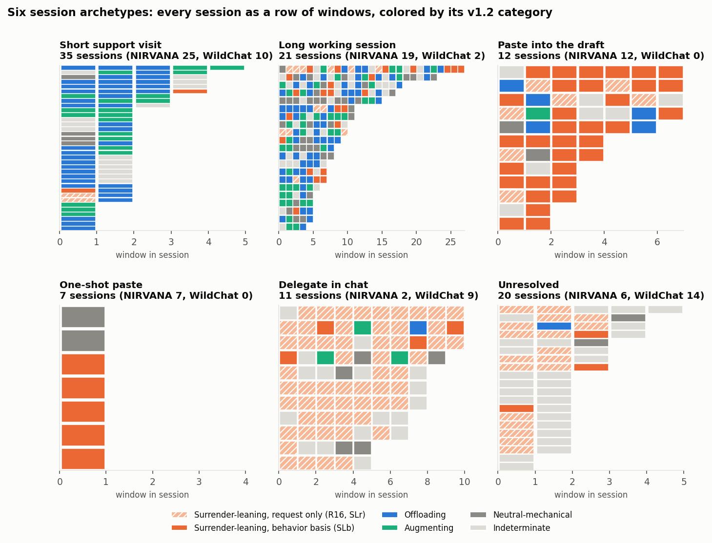
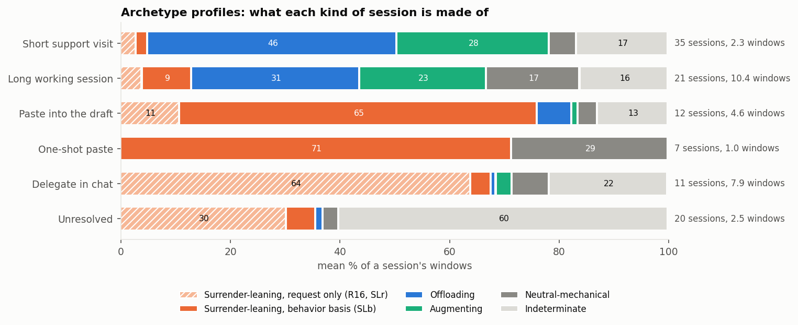
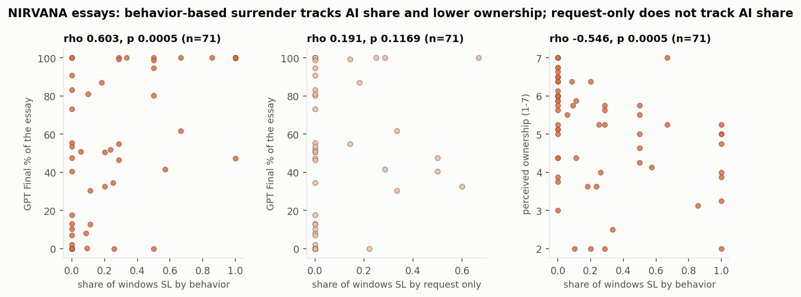
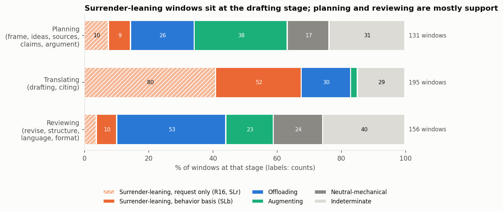
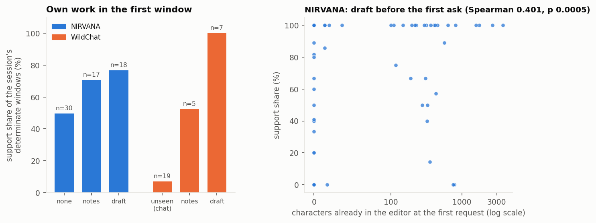
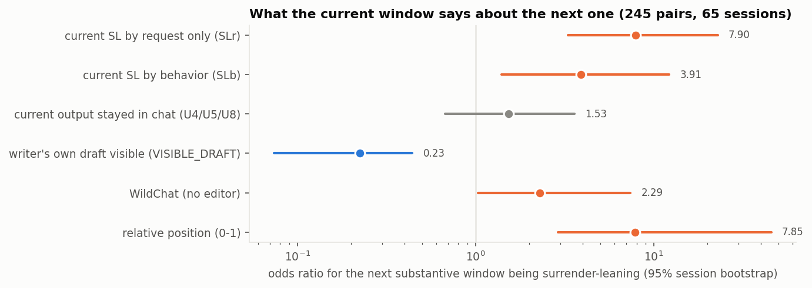
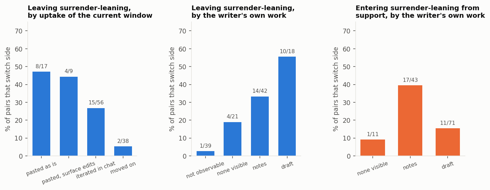
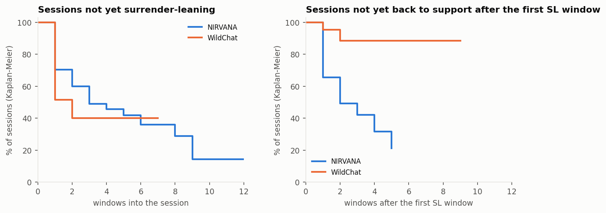
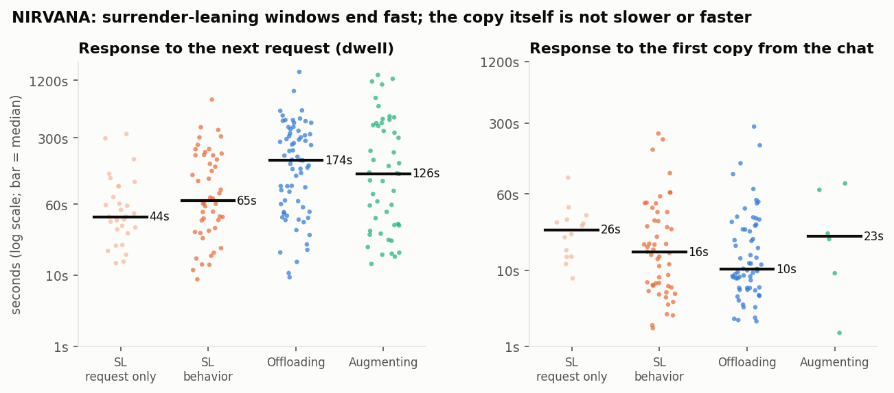
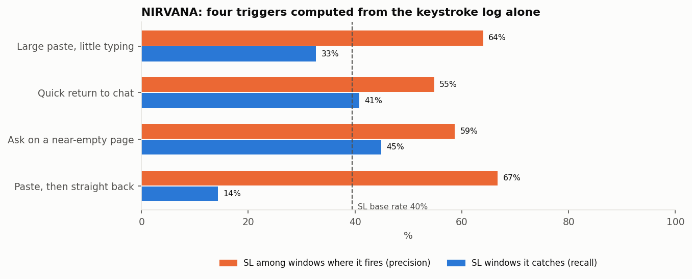

# Offloading or Surrendering? Milestone 2 draft

Wayne Wang · CSE 216 / COGS 230, Fall 2026 · Draft for Wayne's read on Nov 14; due Nov 15.

**How to read this draft.** The draft is built around four theses (§1) that answer RQ1–3 for these 106 writing sessions. Every number comes from a script that reruns from committed labels and committed numeric log facts, with no model calls (`sh Final_Project/analysis/scripts/run_all.sh`). Each claim points to the file that holds it, mostly `analysis/results/mining.md` (cited as "mining §n"). A separate skeptic agent checked every claim against the data (`analysis/SKEPTIC_T.md`), and the wording below is the version that survived. Caveats are collected in §10 rather than repeated per sentence. Narratives are in `narratives.md`. No dataset text is quoted anywhere.

**What Milestone 2 asks for, and where it is.** The course handout is not in the repository. The requirements below are taken from the project brief (`BRIEF.md`, "Milestone 2 requires"), which summarizes the course materials. If the handout asks for something else, this draft has not seen it.

| Requirement (from `BRIEF.md`) | Section |
|---|---|
| Systematic comparison with existing frameworks (Risko & Gilbert, Shaw & Nave, PAUSE, Maier), with cases each cannot distinguish | §4 |
| Review of related work | §3 |
| Codebook applied to 50–100 sequences | §5 (106 whole sessions, 498 windows; 528 windows in all) |
| Agreement statistics and analyzed disagreements | §6 |
| Revised framework | §5.3, §9 |
| Honest reporting of problems and adaptations | §2, §10 |

---

## 1. Summary: four theses

I asked which observable patterns of AI use in writing support the writer's thinking (*offloading*, in Risko & Gilbert's sense: the writer keeps the substance and hands over a demand) and which substitute for it (*surrender*, in Shaw & Nave's sense: AI substance taken over with no visible deliberation). AI coders labeled every request window in 106 whole sessions: 71 timed-essay sessions from NIRVANA, with chat and editor logs, and 35 formal long-form writing conversations from WildChat, chat only. A rule table frozen before these labels existed turned each window's codes into a category. I then mined the sessions for archetypes, transitions, triggers, stage and own-work trajectories, and joined in what the raw logs record: timing, typing and pasting, and NIRVANA's own measures of the finished essay.

**T1 (RQ1, the boundary).** AI use stays on the support side when the content is the writer's own or passes through the writer's hands. It substitutes when AI-generated prose goes into the draft whole, or is only polished, and the writer moves on. Pasting itself is not the line: in NIRVANA, writers paste in 66% of offloading and 64% of behavior-based surrender windows. What differs is what follows. After pasting an AI proposal whole, the writer types a median of 6 characters and is back in the chat in 71 s; after taking part of it, they type 305 characters over 288 s. The finished essays show the same split: the more behavior-based surrender in a session, the more of the essay is AI text (ρ 0.60) and the lower the writer's felt ownership (ρ −0.55) (§7.2).

**T2 (the anchor).** The writer's own text is the anchor. Sessions that start from it lean to the support side (mean support share 0.77 with a draft, 0.50 with nothing visible), and a visible draft predicts that the next request stays there too (odds ratio 0.23). In WildChat (chat only), 2 of 21 sessions that become surrender-leaning come back to support; in NIRVANA 17 of 29 do (§7.3).

**T3 (deliberation, RQ1–2).** In NIRVANA, surrender-leaning windows leave no work on the text. The writer is back in the chat after a median 58 s, against 152 s for support windows, and the gap is typing time: at equal low typing, dwell is the same. The copy is not faster. What is missing is the work afterwards. Writers register that the text is not theirs, since ownership is lower; what they are unlikely to see is that the argument was never worked through (§7.4, §8).

**T4 (signals, RQ3).** A writing tool can see substitution risk from two log events, without reading any content: a request sent on a near-empty page, and a large paste with little typing after it. Together they fire on 140 of 347 NIRVANA windows and catch 63% of surrender-leaning windows, at a precision of 56% against a 40% base rate (§8).

Six archetypes describe the sessions: short support visits, long working sessions, paste into the draft, one-shot paste, delegate in chat, and unresolved (§7.1).

Categories are **literature-grounded inferences from behavior**, not calibrated probabilities and not measurements of anyone's thinking. **No human coded anything.**

## 2. What changed since the proposal, stated plainly

| Change | What the proposal or M1 said | What this draft does | Why |
|---|---|---|---|
| **Who coded** | "I remain the primary coder", with the LLM as a consistency check | **This plan reverses that.** AI agents coded every window (coders A = Claude Opus 5.5, B = Claude Sonnet 5.5; adjudicator = Opus 5.5). A Fable 5.1 agent coded the 20-window gold set in my place | Time; I chose agent-led work on Nov 6 (`PACING.md`) |
| **Agreement** | Human–LLM agreement | **All agreement is AI-to-AI, including the Fable "gold" set.** None of it is human or expert validation | Follows from the row above |
| **Scope** | Research writing | **Formal long-form writing**, reported as one writing activity: NIRVANA timed argumentative essays plus WildChat essays, research papers, reports, proposals, theses and literature reviews | Too few genuine research-writing conversations (the risk named in the proposal). Definition: `wildchat/DEFINITION.md` |
| **Per-window categories** | Codebook v1.0/v1.1 refused to label offloading or surrender per window | v1.2 assigns each window one category with a strength, by a rule table frozen before new labels were read | The proposal's success criterion asks for assignment |
| **What a category is** | – | A literature-grounded inference from behavior, **not a calibrated probability** | Shaw & Nave define surrender partly by absent deliberation, which no log shows |
| **Evidence beyond codes** | Codes only | Timing, typing, pasting and editor length from the raw logs; NIRVANA's own final-essay measures (AI share, felt ownership). Numbers only, committed in `analysis/derived/` | Gives the categories an outside check and gives RQ3 signals that need no coding |
| **Data counts** | M1: 347 windows "from 77 students"; WildChat 42 clear + 40 possible candidates | 347 windows from the **71** NIRVANA students who used ChatGPT; WildChat rescreened in full (§5.1) | Bet 1 rebuild; M1's WildChat candidates were never verified |

## 3. Related work

Full review with sources: `lit/related_work.md`; search protocol and log: `lit/protocol.md`, `lit/search_log.csv`.

**Offloading and surrender.** Risko & Gilbert (2016) define cognitive offloading neutrally, as action that reduces cognitive demand, and note that its benefit depends on whether the removed demand is needed for the goal. Shaw & Nave (2026) separate strategic delegation, where one's own reasoning stays active, from "cognitive surrender", the uncritical adoption of AI output; their signature of surrender needs items with known answers. PAUSE (Alam 2026) and Maier et al. (2026) use "offloading" for the harmful substitution itself. This project uses Risko & Gilbert's sense with Shaw & Nave's condition (codebook v1.2 §9.1).

**Learning consequences.** Bastani et al. (2025) find that unrestricted GPT-4 access in high-school mathematics helps practice and harms later unaided performance. Contractor & Reyes (2026) separate *automation* from *augmentation* in students' essays from logs, and find automation's advantage gone a week later. Maier et al. (2026) classify requested support levels from "how do I start" to "give me the answer".

**Writing process.** Flower & Hayes (1981) supply planning, translating and reviewing; Yukita et al. (2025) argue that delegating writing turns these into planning, waiting and reviewing, which is what T1's stage result shows (§7.2). Wan et al. (2024) place writing systems on a taxonomy adapted from Flower & Hayes.

**Tracing AI-assisted writing.** NIRVANA (Jelson et al. 2026a) records chat and editor events for a timed essay and measures how much AI text enters the essay. Mysore et al. (2025) code follow-up behaviors in in-the-wild writing chats. Reza et al. (2025) review HCI design strategies for co-writing.

**Ownership.** Joshi & Vogel (2025) find that writing with AI lowers psychological ownership. Jelson et al. (2026b) report that students relying on ChatGPT for planning or reviewing felt comparable ownership, and flag this as a concern. Park et al. (2026) find self-efficacy falling and trust rising turn by turn. Felt ownership and observable contribution are different things, which RQ2 turns on.

**Related coding schemes, credited.** The codebook's fields are not new on their own. Poquet et al. (2026) code who directs the interaction and at what level; Chen (2026) codes layers of what is handed over; T. Kim et al. (2025) propose two axes, division of cognitive labor and metacognitive oversight, which map onto this codebook's decision and verification questions; Mysore et al. (2025) separate follow-up types, which v1.1's `U4` subtypes and `U8` follow; Padmakumar et al. (2026) treat offloading as a fraction of steps. This project's contribution is narrower: coding request, origin of content, check and uptake together in one window, chaining windows into whole sessions, and joining codes to what the log records (`lit/codebook_implications.md` recommendation 9).

**Awareness (RQ2).** Skulmowski (2024), H. Kim et al. (2026), Tankelevitch et al. (2024) and Bhat et al. (2026) argue that people can misjudge or miss AI's influence on their own work. None tests this at the level of a single interaction, so RQ2 stays analytic here.

## 4. Comparison with existing frameworks

The full comparison, its 11 case pairs and a critic's corrections are in `lit/framework_comparison.md`. Written before any real window was coded, it concluded that the success criterion "distinguishes cases existing frameworks cannot" was **not established**: the project was the only framework rated Yes on 3 of 11 pairs, two of which NIRVANA's own metrics already separate, and the third was untested.

What the coded data now add:

| Pair (from `lit/framework_comparison.md` §3) | Before coding | Now, on real windows |
|---|---|---|
| 1. Paste a generated essay vs request one and write your own | Project Yes [untested]; NIRVANA metrics also separate it | Both occur: whole paste (`D4 V0 U1`) 32 windows, ask-then-write-own (`D2 U7`) 52; the rules send them to opposite sides (surrender-leaning 30/32 vs support 44/52) (`analysis/results/patterns.md` §1). The log adds what NIRVANA's essay metric cannot: after a whole paste the writer types almost nothing (mining §5) |
| 2. Light edits to an AI draft vs paste with no edits | Project Yes [untested], a thin gain | 45 unchecked `D4` takes into the editor; 43 surrender-leaning. The codes separate paste from surface edit; the categories do not. Surface-only iteration in chat (`D2 V1 U4`) is 30 windows, 21 surrender-leaning |
| 6. Writer's claim reworded vs AI claim adopted | Shaw & Nave Yes [theory]; project Yes [untested] | `D1 F5` 68 windows, mostly offloading; `D4` adoptions surrender-leaning. **Pasting is common on both sides (66% vs 64%); this pair, not paste vs no paste, is the line T1 draws** |
| 7. Checking against a source vs asking the AI to check itself | Project Yes [untested], "may be rare" | Rare but present: 13 reasoned checks (`V3`) in 6 NIRVANA sessions, 5 `V2` windows |
| 5, 8, 11. Checked in another tab; true vs false claim; habit over weeks | Project Cannot | Still Cannot |

The new piece is pair 6 made observable: the same act (paste into the editor) sits on both sides, and the code for whose content it is, together with the typing that follows, separates them. Shaw & Nave and Maier remain stronger on what they were built for (known-answer items; requested-support level).

## 5. Data, codebook and inference layer

### 5.1 Data

| Set | What | Windows | Sessions | Coverage |
|---|---|---|---|---|
| NIRVANA | 30-minute argumentative essays, ChatGPT chat plus editor events (Jelson et al. 2026a). All 71 students who used the chat | 347 | 71, all complete | C1 chat only or C2 chat + editor |
| WildChat (Bet 7) | Formal long-form writing in WildChat-1M, random seed only; one conversation per IP cluster | 151 | 35 whole conversations, turns 1–10 (3 capped) | C1 or C0; no editor ever |
| WildChat (Bet 4 sample) | 30 windows from 11 conversations | 30 | incomplete; **kept out of every session measure** | C1 or C0 |

The WildChat screen (Bet 7, `wildchat/REPORT.md`) labeled a random seed of 1,200 eligible conversations with an LLM, ranked all 139,736 eligible conversations, and confirmed the top 2,500. A second model agreed with 118 of 120 random accepted conversations. That is one model's agreement with another, not human-verified precision.

### 5.2 Codebook v1.1

Each window is one request, the AI's response, and the writer's next action. Q1–Q2 code what was asked (function `F1`–`F8`, operation, object); the process stage (planning, translating, reviewing, monitoring) is derived from the operation by script, after Flower & Hayes. Q3 codes where the content came from and who decided (`D0` no decision, `D1` writer's content, `D2` AI proposal left open, `D3` writer chose or revised, `D4` AI proposal taken). Q4 codes the visible check (`V0` none … `V4` source comparison). Q5 codes uptake (`U1` pasted unchanged … `U7` writer types new text, `U8` moved on). `prior_own_work` records whether the writer's own draft is visible. Revisions from v1.0: `codebook/REPORT.md`.

### 5.3 Inference layer v1.2 (the revised framework)

v1.2 §9 (`inference/CSE216_Writing_Codebook_v1.2.md`) is an ordered rule table, R00–R20 and R99. First match wins, so every window gets one category, `SURRENDER_LEANING`, `OFFLOADING`, `AUGMENTING`, `NEUTRAL_MECHANICAL` or `INDETERMINATE`, with a strength. Each rule cites its source and names the main alternative reading.

- **`NEUTRAL_MECHANICAL` has no source.** It is a project category that follows v1.1's `D0`.
- `AUGMENTING` follows Contractor & Reyes's augmentation. Offloading and augmenting together are **support** below.
- **Two kinds of surrender-leaning** are kept apart throughout: **SLr**, fired by R16 (generation requested, output iterated or accepted in chat: a request-only basis), and **SLb**, fired by any other surrender rule (unchecked paste, surface-only work on AI text: a behavior basis).
- The rules were frozen (sha256 in `inference/FROZEN.md`) before any of the 428 new windows was read, and run here unchanged; `analysis/scripts/check_frozen.py` checks the hash before every run. Fields left `UNSETTLED` go to R00 `INDETERMINATE`, as frozen.

### 5.4 Session measures and log facts

Windows are chained by turn into sessions. Order claims are tested against a within-session shuffle (each session's categories reordered 2,000 times), which keeps a session's make-up and moves only the order. Archetypes come from optimal-matching distance between whole category sequences and average-linkage clustering, with k chosen by silhouette (mining §1).

From the raw logs, `analysis/scripts/extract_raw.py` writes numbers only (`analysis/derived/`): for each NIRVANA window, the time from the response to the first action, first copy and next request (**dwell**), characters typed and pasted before the next request, and the editor's length when the request was sent; NIRVANA's own final-essay measures per student (GPT Final %, the share of the essay that came from the AI; Perceived Ownership, 1–7); and, for WildChat, which stamps only AI turns, the interval between consecutive AI replies.

## 6. Agreement and disagreements

**All agreement here is between AI models.** It measures whether two models apply the same written rules the same way, not whether the codes are right.

| Run | Windows | `decision` κ | `verification` κ | `uptake` κ | Lowest Q3–Q5 subset | Source |
|---|---|---|---|---|---|---|
| Bet 3 pilot, round 4 | 22 | 0.78 | 1.0 | 0.94 | – | `codebook/REPORT.md` |
| Bet 4 sample | 100 | 0.94 | 0.82 | 0.92 | `verification` on C1 0.66 | `coding/REPORT.md` |
| Fable 5.1 vs final, gold | 20 | 0.84 | 1.0 | 0.81 | – | `coding/results/fable_comparison.md` |
| Bet 6 NIRVANA, full history | 295 | 0.80 | 0.79 | 0.85 | `verification` on C2 0.48 [0.17, 0.69] | `sessions/REPORT.md` |
| Bet 7 WildChat | 151 | 0.92 | 0.94 | 0.92 | session interval ≥ 0.61 | `wildchat/REPORT.md` |
| **Categories from A's labels vs B's labels** | 528 | – | – | – | **category κ 0.86** (89.2% agree) | `analysis/results/out_of_sample.md` §7 |

**Adjudicators lean toward the same model.** When coders disagreed, the adjudicator (Opus) sided with coder A (also Opus) 25 to 13 in Bet 4, 159 to 45 in Bet 6 and 54 to 17 in Bet 7. On the 57 windows where A's and B's categories differ, the final category follows A in 44 and B in 12. Totals barely move: surrender-leaning windows in whole sessions number 177 under A's labels, 167 under B's and 167 in the final labels (`out_of_sample.md` §7).

**Analyzed disagreements.** `V0` vs `V1` on editor windows (18 of 20 C2 `verification` disagreements in Bet 6) moves strength between R15 and R16, not category. `prior_own_work` is the weakest WildChat field (κ 0.75) and holds 11 of its 19 `UNSETTLED` cells. `U3` vs `U7` when a writer pastes a short AI phrase and keeps typing has no length rule. Bet 4's truncated histories changed 6 labels and 2 categories when recoded with full history (`out_of_sample.md` §6).

## 7. Results

### 7.0 Base: the frozen rules out of sample

The frozen rules gave a category other than indeterminate to 336 of the 428 new windows (78.5%), against 79 of 100 on the windows they were built on (`out_of_sample.md` §1). By dataset, in whole sessions:

| | Windows | Surrender-leaning (SLr / SLb) | Support | Indeterminate or neutral |
|---|---|---|---|---|
| NIRVANA | 347 | 98 (29 / 69) | 150 | 99 |
| WildChat | 151 | 69 (67 / 2) | 25 | 57 |

In WildChat, surrender-leaning almost always means "asked the AI to write it" (R16), because nothing shows what happened to the text; six rules (R06, R09, R12, R17, R19, R20) cannot fire without an editor. Checks are nearly absent: 13 reasoned checks (`V3`; `V4` 0) in 6 sessions and 5 AI self-checks (`V2`) in 498 windows (mining §10).

### 7.1 Six archetypes

Clustering whole category sequences gives six archetypes (mining §1; names follow fixed thresholds in `mine.py`):

| Archetype | Sessions (NIRVANA / WildChat) | Mean windows | What it is made of | Median GPT Final % (NIRVANA) |
|---|---|---|---|---|
| Short support visit | 35 (25 / 10) | 2.3 | offloading 46%, augmenting 28% | 0.0 |
| Long working session | 21 (19 / 2) | 10.4 | offloading 31%, augmenting 23%, some of everything; 1.7 switches on average | 0.18 |
| Paste into the draft | 12 (12 / 0) | 4.6 | SLb 65% | 0.97 |
| One-shot paste | 7 (7 / 0) | 1.0 | SLb 71% | 1.0 |
| Delegate in chat | 11 (2 / 9) | 7.9 | SLr 64% | – (2 NIRVANA sessions) |
| Unresolved | 20 (6 / 14) | 2.6 | indeterminate 60%, SLr 30% | – |

The two paste archetypes are NIRVANA-only and end with essays almost wholly by the AI; delegation in chat is mostly WildChat. Cluster structure is modest (silhouette 0.25) but stable: 89–98% of session pairs are grouped the same way at k = 4, 5 and 7 (mining §10). Narratives: e41 (paste into the draft), e24 (short support visit), e70 and e26 (long working sessions), WildChat 2849709b14c2 (delegate in chat), all in `narratives.md`.

### 7.2 T1: the boundary is whether AI text passes through the writer's hands

**Pasting is on both sides.** In NIRVANA, writers paste into the editor in 65.5% of offloading windows and 63.8% of behavior-based surrender windows (mining §5). What separates them is whose content was pasted and what the writer did next:

| NIRVANA windows with a paste | Windows | Category | Median characters typed after | Median dwell |
|---|---|---|---|---|
| AI proposal taken whole (`D4`) | 42 | SLb 39 | 6 | 70.5 s |
| Part taken or revised (`D3`) | 32 | offloading 28 | 304.5 | 288.1 s |
| Writer's own text, reworked by the AI (`D1`) | 29 | offloading 28 | 25 | 150.1 s |

Source: mining §5. The category column restates the rules, and "typed after" partly restates how `D3` and `D4` are defined. Dwell does not.

**The finished essays show the same line.** NIRVANA records how much of each final essay came from the AI and asks writers how much they own it. Across the 71 sessions, the share of behavior-based surrender windows tracks the AI share of the essay (ρ 0.60, p 0.0005) and lower felt ownership (ρ −0.55, p 0.0005). Both hold without one-window sessions (0.54, −0.49). Request-only surrender tracks the AI share only weakly (ρ 0.19, p 0.12). Sessions with any behavior-based surrender window end with a median essay 81% AI; sessions without one, 0% (34 vs 37 sessions) (mining §8, §10).

**Substitution is a request for prose.** 80% of drafting-stage windows are surrender-leaning, against 23% of planning and 17% of reviewing windows. This is close to definitional: 192 of 195 drafting windows are generation requests (`F4`), and those feed the surrender rules. The informative part is the other side: requests that are not for generated prose are almost never surrender-leaning (7% when planning, 10% when reviewing). Planning comes early in sessions and reviewing late (both p 0.0005 against the shuffle) (mining §4, §10). This is Yukita et al.'s point in data: what gets delegated is translating.

**Entering and leaving.** Moves from support into surrender-leaning most often land on a generation request iterated in chat (`D2 U4`, 18 of 29). Moves back out most commonly land on the writer revising AI text in the editor (`D3 U3`, 8 of 29) (mining §3). Narrative e70 shows the turn inside one session: the writer polishes their own paragraphs, then asks for text they do not have and pastes it.

### 7.3 T2: the writer's own text is the anchor

- **Starting from own text.** Across NIRVANA sessions, the more text in the editor at the first request, the larger the session's support share (ρ 0.40, p 0.0005; 0.26, p 0.075, on multi-window sessions alone). Sessions whose first window shows a running draft have a mean support share of 0.77; with notes, 0.71; with nothing visible, 0.50. In WildChat, the 7 conversations that open with the writer's draft have no surrender-leaning window; 18 of the 19 where no own work is visible do (mining §5, §10).
- **Next request.** In a model of the next substantive window, a visible draft predicts lower odds of surrender-leaning (odds ratio 0.23, 95% session bootstrap 0.07–0.44), with the current category, chat uptake, dataset and position in the model. The current window being request-only surrender is the larger predictor (odds ratio 7.9) (mining §3).
- **Switching.** In NIRVANA, writers leave surrender-leaning in 9 of 17 transitions when their draft is visible, 14 of 34 with notes, 4 of 21 with nothing visible. From support, they enter surrender-leaning in 16 of 41 transitions with only notes and 10 of 59 with a draft (mining §3, NIRVANA rows).
- **Coming back.** Of sessions whose first surrender-leaning window is not their last, 17 of 29 in NIRVANA later return to support; 2 of 21 in WildChat do (mining §6).
- **The draft grows.** NIRVANA's median editor length at the time of request rises from 101 characters in the first fifth of a session to 2,157 in the last (mining §5).

*fig21 pools both datasets (its "not observable" bar is WildChat); the NIRVANA counts are in the Switching bullet above.*

Narrative e24 shows the anchor in one session: the writer asks while a paragraph of their own is half written, and answers each reply with their own paragraph.

### 7.4 T3: surrender-leaning windows leave no work on the text

- **Dwell.** In NIRVANA, the time from the AI's response to the writer's next request has a median of 58 s for surrender-leaning windows and 152 s for support windows (within-session shuffle p 0.0005). Behavior-based surrender alone is 65 s (p 0.0035). The gap appears in every fifth of the session (SL 41–69 s, support 118–219 s) and within 13 of the 17 sessions that have both (mining §7, §10).
- **The gap is typing.** Where the writer typed under 50 characters, behavior-based surrender and support windows have the same dwell (44 s and 44 s). Median characters typed after the response: 0 for behavior-based surrender, 108 for offloading, 256 for augmenting (mining §5, §10).
- **The copy is not faster.** The first copy from the chat comes after a median 15.5 s for behavior-based surrender, 10.4 s for support (p 0.62) and 10.3 s for offloading; 20 of 69 behavior-based surrender and 31 of 87 offloading windows are copied within 10 s (mining §7).
- **WildChat cannot test this.** Its one clock, AI reply to next AI reply, includes generation time and does not separate the sides (232 vs 332 s, p 0.39).

Narrative e41 is the extreme case: six chat turns on an empty page, each AI draft on screen for under 21 s before the next request, then one paste of 4,681 characters. The essay is 100% AI by NIRVANA's measure, and the writer rated their ownership 3.1 of 7.

## 8. RQ2 and RQ3

### RQ2: which substitutions are likely to go unnoticed (analytic)

The proposal promised no user study, so this is an argument from the patterns and the literature.

Shaw & Nave define surrender by absent deliberation. No log shows deliberation, but logs show its usual by-product, work on the text, and that is near zero exactly where AI substance is taken over (T3). Reasoned checks, the visible form of deliberation, are nearly absent (13 in 498 windows). Writers do register *origin*: felt ownership is lower in sessions with either kind of surrender (ρ −0.55 for behavior-based, −0.33 for request-only), as Joshi & Vogel (2025) found. So the substitution a writer can see is that the text is not theirs. What a writer is unlikely to see is that its argument was never worked through, the gap H. Kim et al. (2026) call the "LLM fallacy".

| Pattern | Likely noticed? | Why |
|---|---|---|
| Whole paste of AI text (`D4 U1`) | The origin, yes; the missing reasoning, no | Pasting is deliberate, and ownership is lower in these sessions. But the writer types almost nothing afterwards (T3), so nothing in the session works the argument through |
| Surface-only iteration on an AI draft (`D2 V1 U4`, 30 windows) | Less likely | The writer is busy with length and tone, which feels like editing; Shaw & Nave's routes to deliberation include no surface-edit route (e41) |
| Ideas from a generation request, written up in the writer's own words (`D2 U7`, 52 windows, 37 augmenting) | Least likely | The writer types, so ownership need not fall (Jelson et al. 2026b found planning and reviewing reliance kept ownership; Bhat et al. 2026 report unnoticed influence). The codebook cannot see idea origin, by design (e24, R17's weak strength) |
| Request-only delegation in chat (R16) | Unknown to us | The log ends at the request; in WildChat the writer may use the text off-screen |

### RQ3: in-situ feedback triggers

| Trigger | Fires when | Evidence (NIRVANA, mining §9–10) | Proposed feedback (mockup level) |
|---|---|---|---|
| **Ask on a near-empty page** | A request is sent while the editor holds under 200 characters | Fires on 101 of 347 windows; 59% of the windows it fires on are surrender-leaning (base 40%); catches 45% of surrender-leaning windows; sessions where it fires more report lower ownership (ρ −0.28). Backed by T2 | Before showing generated prose, ask the writer for the claim they want to make, and show the AI's reply beside it |
| **Large paste, little typing** | 200+ characters pasted and under 50 typed before the next request | Fires on 55 windows; 64% surrender-leaning; catches 46% of behavior-based surrender; sessions where it fires more report lower ownership (ρ −0.41) | After the paste, ask which sentence of it the writer would defend or change, and highlight the pasted span until it has been edited |
| **Either of the two** | – | Fires on 140 windows; 56% surrender-leaning; catches 63% of surrender-leaning and 70% of behavior-based windows | – |
| Not a trigger: quick return to chat | Next request within 60 s, under 50 typed | 55% surrender-leaning, no relation to essay outcome (ρ 0.14 with AI share) | Speed alone should not prompt anything |

The two triggers read only the editor's length and character counts, never the text. In a chat-only tool neither event exists. The nearest analogue there is a run of generation follow-ups where the writer supplies no text of their own: such runs are only slightly more common than chance (46 vs 40.5, p 0.025), and WildChat sessions that become surrender-leaning rarely come back to support (2 of 21).

## 9. Revised framework: what v1.3 should change (proposed, not applied)

v1.2 stays frozen for this milestone. The data suggest these changes for a v1.3 with a logged rerun:

- **Split R16.** Request-only surrender tracks the essay's AI share only weakly (ρ 0.19) while behavior-based surrender tracks it strongly (0.60). "Asked the AI to write it" with no adoption seen should be its own pattern, not weak surrender-leaning. 48 of the 96 whole-session R16 windows are "asked for text, then did not use it" (`U8`).
- **Add a log field for work after the response.** Characters typed and pasted before the next request separate the sides where codes alone cannot (T1, T3) and are computable by script.
- **Narrow R00.** 16 of the 20 windows with an `UNSETTLED` field get the same category under every value of that field (`out_of_sample.md` §5).
- **Add a length rule for `U3` vs `U7`** and a `V0`/`V1` rule for editor windows.
- **Cover the commonest R99 gaps**: AI rework of AI text kept in chat (`D2 F5 U4`, 13), options or plans left open in chat (`D2 F2/F3 U4`, 14), generation followed by own typing with no visible draft (`D2 F4 U7`, 5) (`out_of_sample.md` §9).
- **Allow "unknown, pasted" for `prior_own_work`** in chat, which would settle most WildChat `UNSETTLED` cells.

## 10. Limitations

- **No human coded anything.** Every label and every agreement figure is AI-to-AI, including the Fable 5.1 "gold" set. The proposal said "I remain the primary coder"; this plan reverses that.
- **Categories are literature-grounded inferences, not calibrated probabilities**, and not measurements of cognition. Each rule keeps its alternative reading open, for example that a writer evaluated AI text silently before pasting it.
- **`NEUTRAL_MECHANICAL` has no source.**
- **V2–V4 are essentially absent** (13 `V3`, 0 `V4`, 5 `V2`; mining §10), so the framework's verification distinctions rest on very few windows.
- **Adjudicators lean toward the same model** (Bet 4 25:13, Bet 6 159:45, Bet 7 54:17); where the coders' categories differ, the final follows A 44 to 12; totals barely move (§6).
- **In WildChat, surrender-leaning mostly means "asked the AI to write it"** (67 of 69 windows rest on R16, request type alone).
- **Some links are partly built in.** The category column of the paste table and "typed after" restate how `D3` and `D4` are defined; the stage result is close to definitional, since drafting windows are generation requests; GPT Final % measures AI text surviving in the essay, so its link to pasting is expected. Dwell and felt ownership are not built in.
- **Between, not within.** The own-work links (T2) and the ownership link hold across sessions more than within them. Bet 8's shuffle found no turn-to-turn stickiness once a session's make-up is fixed, so "predicts" means across sessions.
- **Many tests, uncorrected**: 40 category n-grams, 29 signature n-grams, 20 latency contrasts, 12 outcome correlations, 4 triggers, plus Bet 8's order tests. The theses rest on the large effects (outcome ρ ≈ 0.6, dwell 58 vs 152 s, trigger precision), not on p-values near 0.05.
- **NIRVANA carries T1's paste evidence, T3 and T4.** WildChat has no editor and stamps only AI turns.
- **Archetypes describe these sessions**; the structure is modest (silhouette 0.25).
- **Scope was adapted** from research writing to formal long-form writing; NIRVANA is a timed 30-minute essay. Nothing here speaks to habits over weeks.
- **The framework comparison was made by the project's own agent**, corrected by a critic (§4).
- **Ownership is NIRVANA's self-report**; I rely on the dataset's description of when and how it was asked.

## 11. Plan to the final report

Apply M2 feedback; decide on v1.3 (§9) with a logged rerun, starting with the R16 split and a typed-after field; consider a small human check of categories (for example, Wayne reading 20 windows blind), reported as such; build mockups for the two triggers; write the final RQ1–3 answers from the theses.

## References

Full list with read levels: `inference/CSE216_Writing_Codebook_v1.2.md` §11 and `lit/related_work.md`. Cited here: Alam 2026 (PAUSE, arXiv:2609.13155, abstract only); Bastani et al. 2025 (*PNAS* 122(26)); Bhat et al. 2026; Chen 2026 (doi:10.3389/fpsyg.2026.1906199); Contractor & Reyes 2026 (arXiv:2607.08849); Flower & Hayes 1981; H. Kim et al. 2026; T. Kim et al. 2025 (doi:10.1002/arcp.70008, abstract only); Jelson et al. 2026a (NIRVANA, arXiv:2604.07344); Jelson et al. 2026b (CHI 2026, doi:10.1145/3772318.3791056); Joshi & Vogel 2025 (doi:10.1145/3719160.3736608); Maier et al. 2026 (arXiv:2609.20143); Mysore et al. 2025 (doi:10.18653/v1/2025.emnlp-main.852); Padmakumar et al. 2026 (arXiv:2605.29392); Park et al. 2026 (doi:10.1145/3772318.3790276); Poquet et al. 2026 (doi:10.1007/978-3-032-37979-5_34); Reza et al. 2025 (arXiv:2504.12488); Risko & Gilbert 2016 (doi:10.1016/j.tics.2016.07.002); Shaw & Nave 2026 (SSRN 6097646); Skulmowski 2024; Tankelevitch et al. 2024; Wan et al. 2024; Yukita et al. 2025 (preprint); Zhao et al. 2024 (WildChat, arXiv:2405.01470).
